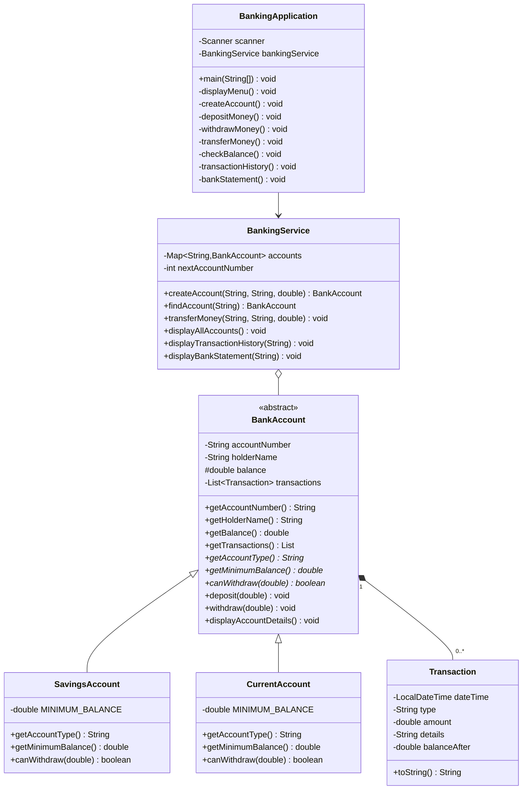

# UML Class Diagram – Banking System

## 1. Class Diagram

## 2. Class Descriptions

### BankAccount
An abstract parent class that stores common account information and implements deposit and withdrawal operations.

### SavingsAccount
Extends `BankAccount` and enforces the assignment's minimum balance of Rs. 500.

### CurrentAccount
Extends `BankAccount` and enforces the assignment's minimum balance of Rs. 1,000.

### Transaction
Stores the date, transaction type, amount, details, and balance after a transaction.

### BankingService
Creates accounts, searches for accounts, processes transfers, and displays account and transaction information.

### BankingApplication
Contains the `main()` method and the console menu used to interact with the banking system.

## 3. OOP Concepts Used

- **Encapsulation:** Account fields are private or protected, with public methods for controlled access.
- **Inheritance:** `SavingsAccount` and `CurrentAccount` extend `BankAccount`.
- **Polymorphism:** Each account type implements its own `getAccountType()`, `getMinimumBalance()`, and `canWithdraw()` methods.
- **Abstraction:** `BankAccount` defines common behavior and abstract methods for account-specific rules.

## 4. Relationship Summary

- `SavingsAccount` inherits from `BankAccount`.
- `CurrentAccount` inherits from `BankAccount`.
- A `BankAccount` maintains a collection of `Transaction` records.
- `BankingService` manages multiple bank accounts.
- `BankingApplication` uses `BankingService` to perform banking operations.